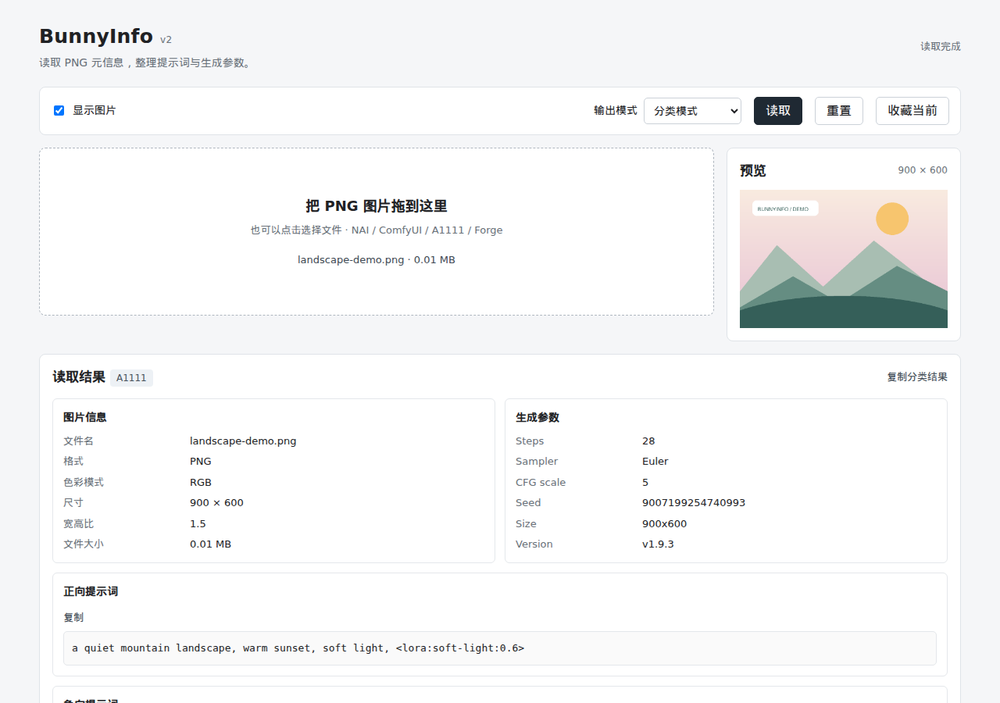
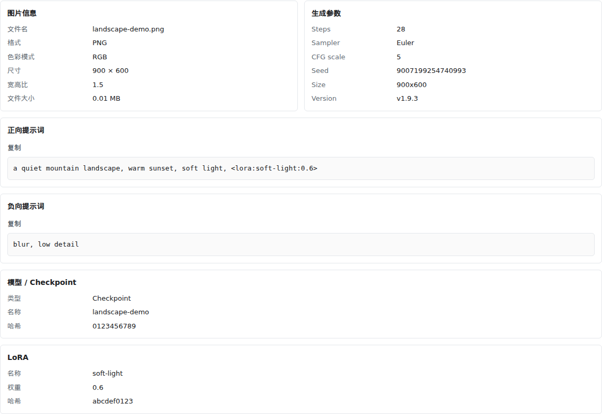
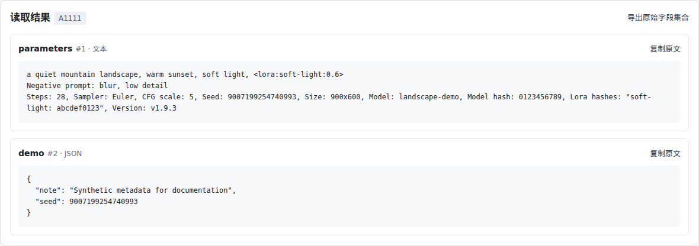
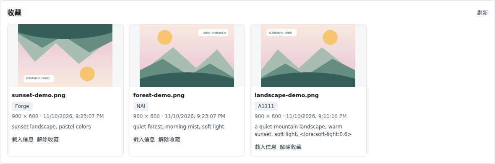

<div align="center">

<h1>BunnyInfo</h1>


<p>面向 AI 绘图玩家的轻量 PNG 元信息工具。<br>查看提示词、生成参数和模型记录，把喜欢的图片留在本地。</p>

<p>
  <a href="https://github.com/WangZhenYu-T/BunnyInfo/releases"></a>
  
  
</p>

<p><strong><a href="https://github.com/WangZhenYu-T/BunnyInfo/releases">下载 Windows 版</a></strong> · <a href="CHANGELOG.md">更新记录</a> · <a href="#english">English</a></p>

</div>

## 简体中文

### 支持平台

- **Windows 10 / 11 x64**：解压即用，无需安装 Python 或配置环境。
- **Linux / macOS**：可通过源码运行；当前自动测试覆盖 Windows 和 Ubuntu。
- 当前支持 **PNG，最大 30 MB**。界面使用中文。

### 屏幕截图

<table>
  <tr>
    <td><p align="center">图片读取与预览</p></td>
    <td><p align="center">提示词与模型记录</p></td>
  </tr>
  <tr>
    <td><p align="center">JSON 与原文复制</p></td>
    <td><p align="center">本地收藏</p></td>
  </tr>
</table>

### 功能

- **分类阅读**：整理 NAI、A1111、Forge 的正负提示词、生成参数，以及图片中记录的 checkpoint / LoRA 信息；支持 NAI 角色提示词。
- **原文保留**：按字段格式化 JSON、复制原始文本或导出字段集合，保留重复文本键、压缩文本与大整数 seed 精度。
- **ComfyUI 提示词**：仅从简单、明确的连接提取；复杂 prompt 图和 workflow 在 JSON 中查看，也可将图片直接拖入 ComfyUI。
- **本地收藏**：保存原始 PNG 和解析结果，显示来源标识。无生成元信息的 PNG 同样可以预览和收藏。
- **轻量即用**：桌面包自带运行环境，通过浏览器使用，关闭启动窗口即可退出。

| 来源 | v2 分类内容 | 原始字段 |
|---|---|---|
| NAI | 正负及角色提示词、可用参数、模型信息 | 保留 |
| A1111 / Forge | 提示词、参数、已记录的 checkpoint、LoRA 与哈希 | 保留 |
| ComfyUI | 简单且无歧义的保存路径所对应的提示词 | 保留 prompt 图及内嵌 workflow |
| 其他 PNG | 图片信息、未识别或空状态 | 展示可用文本 |

图片未保存的信息无法恢复。ComfyUI 分类不推断工作流中哪些节点启用；v2 尚不包含模型盘点和 Civitai 哈希查询。

### 下载与使用

在 **[Releases](https://github.com/WangZhenYu-T/BunnyInfo/releases)** 下载 Windows ZIP。

**已发布的 v1 / v2 保留旧名称**：附件分别为 `Lite-PngInfo-v1-Windows-x64.zip`、`Lite-PngInfo-v2-Windows-x64.zip`，包内程序为 `Lite-PngInfo.exe`。它们是本项目的历史发行包，无需改名；后续新包统一使用 BunnyInfo。

1. **完整解压**到可写目录，例如桌面。
2. 双击 **Lite-PngInfo.exe**（v1 / v2 历史包；后续新包为 **BunnyInfo.exe**），浏览器自动打开。
3. 选择或拖入 PNG，点击 **读取**；按需切换分类 / JSON 模式或收藏图片。

请保留 exe 旁的 `_internal` 文件夹，不要直接在 ZIP 内运行。启动窗口提供“打开浏览器”和“退出”按钮；关闭网页不会停止程序，关闭启动窗口才会退出。默认端口被占用时会自动选择空闲端口。

### 版本与计划

| 版本 | 主要内容 |
|---|---|
| v1 | NAI 元信息、JSON、预览与本地收藏。 |
| v2 | 增加 A1111 / Forge 分类、保守的 ComfyUI 提示词提取、原始字段浏览、角色提示词与明确空状态。 |
| v3 · 计划 | ComfyUI workflow 模型盘点、Civitai 后台哈希查询。尚未实现。 |

收藏大图查看器保留为后续可选增强。已发布变更见 [CHANGELOG.md](CHANGELOG.md)。

### 数据与隐私

v2 的图片解析与收藏在本机完成，不向外部服务上传图片或提示词，无需账号，读取可离线进行。应用只监听本机地址。

收藏位于程序旁的 `data/favorites.sqlite3`。移动程序或升级时，**先退出程序，备份并携带整个 `data/` 文件夹**。打开旧收藏时，v2 会按需更新解析结果；首次写回升级结果前创建 `data/favorites.before-v2.sqlite3`。解除收藏只修改当前数据库，不会同步删除旧备份中的副本。回退旧版时请使用原数据库的独立副本。

### 常见问题

<details>
<summary>Windows 提示未知发布者怎么办？</summary>

当前程序未做代码签名，Windows 可能显示发布者或信誉提示。请确认文件来自本仓库的 Release；页面附有 SHA-256 校验文件。受组织管理的电脑可能限制未签名程序运行。

</details>

<details>
<summary>为什么读不到提示词或模型？</summary>

部分图片没有保存生成信息，转存、截图或平台压缩也可能移除元信息。程序仍会显示图片信息与可用的原始字段。ComfyUI 复杂图默认留在 JSON，不将旁支数据猜作当前图片的生成参数。

</details>

<details>
<summary>源码运行与开发</summary>

需要 Python 3.10+ 和 Pillow，无需前端构建。使用虚拟环境安装依赖：

```sh
python -m venv .venv
```

Windows：

```bat
.venv\Scripts\python -m pip install -r requirements.txt
.venv\Scripts\python app.py
```

Linux / macOS（可用 `python3` 创建虚拟环境）：

```sh
.venv/bin/python -m pip install -r requirements.txt
.venv/bin/python app.py
```

打开 <http://127.0.0.1:8765>，按 Ctrl+C 停止。源码支持 `BUNNYINFO_HOST`、`BUNNYINFO_PORT`，默认仅监听本机，未提供用户认证。使用同一解释器运行 `-m unittest discover -s tests -v`；测试采用合成图片、临时数据库和端口，CI 覆盖 Windows / Ubuntu × Python 3.10 / 3.13。

</details>

---

## English

BunnyInfo is a lightweight PNG metadata viewer for AI image creators. Read prompts, generation settings, and recorded model information, and keep favorite images locally.

### Platforms

- **Windows 10 / 11 x64**: extract and run, with no Python installation or setup.
- **Linux / macOS**: run from source. Automated tests currently cover Windows and Ubuntu.
- Supports **PNG files up to 30 MB**. The interface is in Chinese.

### Screenshots

<table>
  <tr>
    <td><p align="center">Image reader and preview</p></td>
    <td><p align="center">Prompts and model information</p></td>
  </tr>
  <tr>
    <td><p align="center">JSON and original text</p></td>
    <td><p align="center">Local favorites</p></td>
  </tr>
</table>

### Features

- **Categorized metadata**: NAI, A1111, and Forge prompts, settings, and recorded checkpoint / LoRA information, including NAI character prompts.
- **Original text**: formatted JSON fields, original-text copying, and ordered field exports. Duplicate keys, compressed text, and large integer seeds are preserved.
- **Conservative ComfyUI parsing**: prompts from simple, unambiguous paths. Inspect complex prompt graphs and workflows in JSON or drop the PNG into ComfyUI.
- **Local favorites**: store original PNGs and metadata with source labels. Images without generation metadata can also be previewed and saved.
- **Portable desktop app**: bundled runtime, a browser interface, and a small launcher window to open or stop the app.

| Source | v2 categorized view | Original fields |
|---|---|---|
| NAI | Positive/negative and character prompts, available settings and model information | Preserved |
| A1111 / Forge | Prompts, settings, recorded checkpoints, LoRAs and hashes | Preserved |
| ComfyUI | Prompts from a simple, unambiguous saved-image path | Prompt graph and embedded workflow preserved |
| Other PNGs | Image details and an unrecognized/empty state | Available text |

Information not stored in the image cannot be recovered. ComfyUI classification does not infer active nodes. Model inventory and Civitai hash lookup are not included in v2.

### Download and use

Download a Windows ZIP from **[Releases](https://github.com/WangZhenYu-T/BunnyInfo/releases)**.

**Published v1 / v2 packages retain their original names**: `Lite-PngInfo-v1-Windows-x64.zip` and `Lite-PngInfo-v2-Windows-x64.zip`, containing `Lite-PngInfo.exe`. These are this project's historical releases; no renaming is needed. Future packages use BunnyInfo.

1. **Extract the entire ZIP** to a writable folder.
2. Open **Lite-PngInfo.exe** for the v1 / v2 packages (**BunnyInfo.exe** for future packages); your browser opens automatically.
3. Choose or drop a PNG and click **读取** (Read). Switch between categorized / JSON views or save a favorite.

Keep `_internal` beside the executable and do not run inside the ZIP. The launcher provides Open browser and Exit buttons. Closing the web page does not stop the app; close the launcher to exit. An available port is chosen when the default port is occupied.

### Versions and plans

| Version | Highlights |
|---|---|
| v1 | NAI metadata, JSON, preview, and local favorites. |
| v2 | A1111 / Forge classification, conservative ComfyUI prompts, original fields, character prompts, and explicit empty states. |
| v3 · Planned | ComfyUI workflow model inventory and background Civitai hash lookup. Not implemented. |

The independent favorite-image viewer remains an optional future enhancement. Released changes are recorded in [CHANGELOG.md](CHANGELOG.md).

### Data and privacy

v2 parses images and stores favorites locally. It does not upload images or prompts to an external service, needs no account, and reads images offline. The application binds only to localhost.

Favorites are stored beside the application in `data/favorites.sqlite3`. **Close the app, back up, and carry the entire `data/` folder when moving or upgrading.** v2 reparses old favorites on demand and creates `data/favorites.before-v2.sqlite3` before the first upgraded result is written back. Deleting a favorite changes the active database, not older backups. Use a separate original database copy when reverting to an older version.

### FAQ

<details>
<summary>Why does Windows report an unknown publisher?</summary>

The executable is unsigned, so Windows may display a publisher or reputation warning. Download from this repository's Releases; SHA-256 checksum files are provided. Organization-managed computers may restrict unsigned applications.

</details>

<details>
<summary>Why are prompts or models missing?</summary>

Some images contain no generation metadata. Re-saving, screenshots, or platform processing may remove it. Image details and available original fields remain accessible. Complex ComfyUI graphs stay in JSON rather than presenting unrelated branches as the current image's settings.

</details>

<details>
<summary>Run from source and development</summary>

Requires Python 3.10+ and Pillow; no frontend build is needed. Create a virtual environment:

```sh
python -m venv .venv
```

Windows:

```bat
.venv\Scripts\python -m pip install -r requirements.txt
.venv\Scripts\python app.py
```

Linux / macOS (use `python3` to create the environment where needed):

```sh
.venv/bin/python -m pip install -r requirements.txt
.venv/bin/python app.py
```

Open <http://127.0.0.1:8765>; press Ctrl+C to stop. Source runs accept `BUNNYINFO_HOST` and `BUNNYINFO_PORT`, default to localhost, and have no user authentication. Run `-m unittest discover -s tests -v` with the same interpreter. Tests use synthetic images and temporary databases/ports; CI covers Windows / Ubuntu × Python 3.10 / 3.13.

</details>
