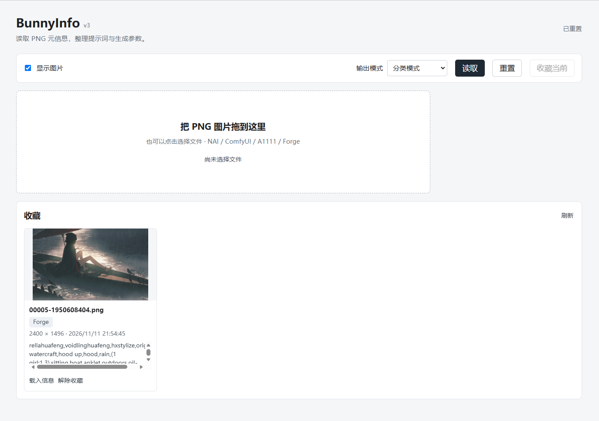
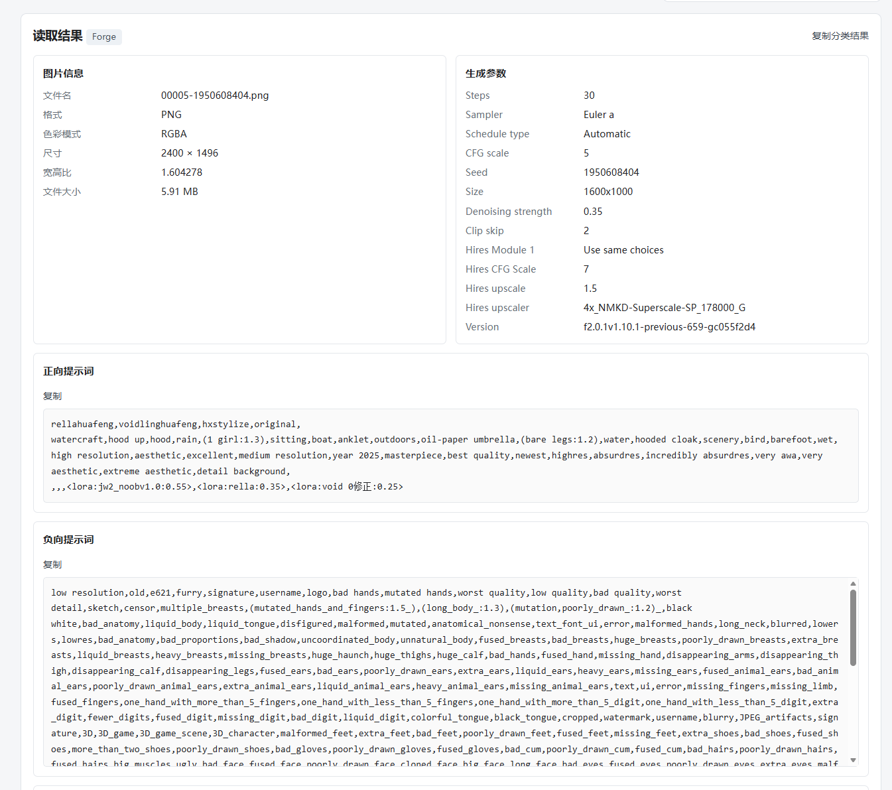
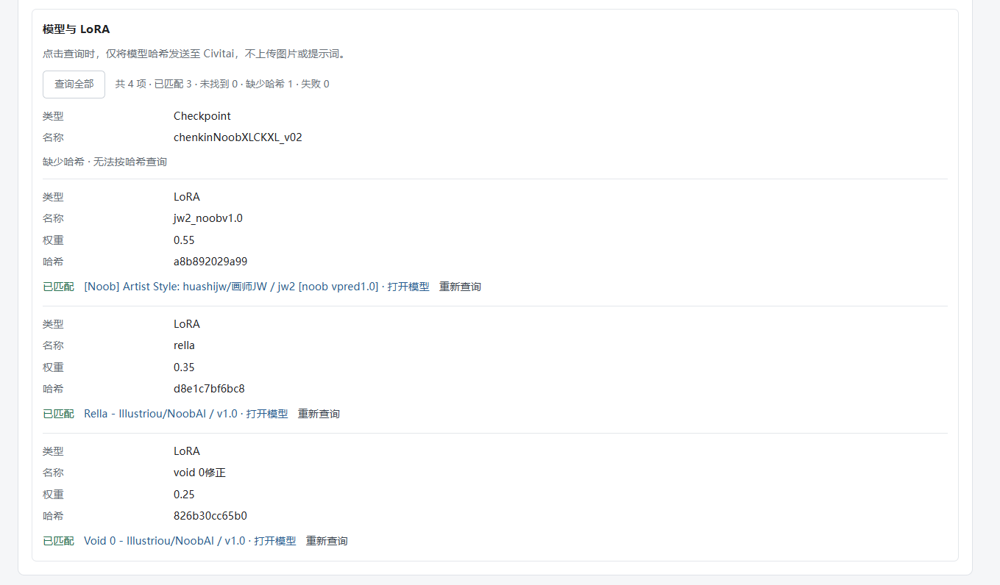
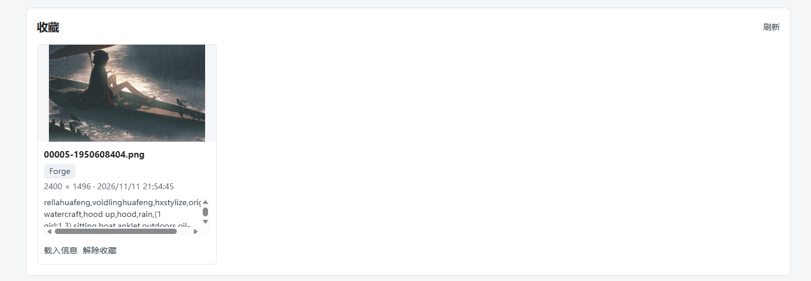

<div align="center">

<h1>BunnyInfo</h1>


<p>面向 AI 绘图玩家的轻量 PNG 元信息与模型溯源工具。<br>读取提示词与生成参数，按哈希找回 Civitai 上的 checkpoint 和 LoRA。<br><s>爱丽丝小兔包可爱捏</s></p>

<p>
  <a href="https://github.com/WangZhenYu-T/BunnyInfo/releases"></a>
  
  
</p>

<p><strong><a href="https://github.com/WangZhenYu-T/BunnyInfo/releases">下载 Windows 版</a></strong> · <a href="CHANGELOG.md">更新记录</a> · <a href="https://github.com/WangZhenYu-T/BunnyInfo/issues">问题反馈</a> · <a href="#english">English</a></p>

</div>

## 简体中文

**你是否有时想查看某张图的画师串与提示词，却懒得打开webui/comfyui**

**你是否遇见一些好图，想找到lora的来源，却懒得一个个搜**

**你是否会对roll出的个别作品及其提示词特别满意，需要收藏起来**

**那么这款主打轻量化的元信息提取工具就非常适合你！！！**

### 功能

- **分类模式**：读取 NAI、A1111、Forge 的正负提示词、生成参数与模型记录，支持 NAI 角色提示词。
- **JSON 模式**：格式化浏览字段、逐项复制原文或导出字段集合，保留重复文本字段和大整数 seed 精度。
- **Civitai 模型定向检索查询**：按图片中记录的模型哈希查询 checkpoint 和 LoRA，在应用内显示匹配结果，一键打开对应版本。
- **本地收藏**：保存原始图片与解析结果；没有生成元信息的 PNG 也能预览和收藏。同时支持将收藏图片重载。
- **支持关闭图片显示**：带来更好的隐私体验

### 屏幕截图

<table>
  <tr>
    <td width="50%"><a href="assets/未读取状态.png"></a><p align="center">主界面</p></td>
    <td width="50%"><a href="assets/读取到的元信息.png"></a><p align="center">生成参数与提示词</p></td>
  </tr>
  <tr>
    <td><a href="assets/模型哈希检索.png"></a><p align="center">Civitai 模型检索</p></td>
    <td><a href="assets/收藏栏.png"></a><p align="center">本地收藏</p></td>
  </tr>
</table>

### 下载与使用

在 **[Releases](https://github.com/WangZhenYu-T/BunnyInfo/releases)** 下载 **BunnyInfo-v3-Windows-x64.zip**，支持 Windows 10 / 11（64 位）。无需安装 Python 或配置依赖。

1. 将 ZIP **完整解压到本地可写目录**。
2. 双击 **BunnyInfo.exe**，浏览器自动打开。
3. 选择或拖入 PNG，点击 **读取**；切换分类 / JSON 查看信息，或点击 **收藏当前** 保存图片。
4. 在模型条目中点击 **查询**，或使用 **查询全部**；匹配成功后点击 **打开模型** 进入对应的 Civitai 版本页。

保留 exe 旁的 `_internal` 文件夹，不要直接在压缩包中运行。关闭启动窗口即可退出程序；关闭网页不会停止服务。默认端口被占用时，桌面版会自动选择空闲端口。

v1 / v2 历史发行包保留原名称：`Lite-PngInfo-v1-Windows-x64.zip`、`Lite-PngInfo-v2-Windows-x64.zip`，包内程序为 `Lite-PngInfo.exe`。

### 格式支持

当前读取 **PNG，最大 30 MB**，界面使用中文。

| 来源            | 分类内容                            | 原始字段                    |
| ------------- | ------------------------------- | ----------------------- |
| NAI           | 正负及角色提示词、可用生成参数、模型信息            | 保留                      |
| A1111 / Forge | 提示词、参数、已记录的 checkpoint、LoRA 与哈希 | 保留                      |
| ComfyUI       | 可以可靠提取的提示词，以及已识别的工作流模型引用        | 保留 prompt 图和内嵌 workflow |
| 其他 PNG        | 图片信息、未识别或无元信息提示                 | 展示可用文本                  |

ComfyUI 模型列表包含工作流中记录的模型，**不代表它们处于启用状态**，请在 ComfyUI 中确认。自定义节点或动态文件名可能无法识别；完整工作流可在 JSON 中查看，或将图片直接拖入 ComfyUI。

图片未保存的信息无法恢复。只有模型名称、没有模型哈希的条目会显示“缺少哈希”，不能按哈希检索。Civitai 未收录、已删除或不可见的模型版本也可能无法找到。

### 本地数据与隐私

图片解析和收藏在本机完成，无需账号，读取图片可离线进行。**只有点击模型查询时才连接 Civitai**，发送模型哈希，不上传图片、提示词或完整工作流。Civitai 会收到查询哈希和来源 IP。

收藏保存在程序旁的 `data/favorites.sqlite3`。升级或移动程序前，请先退出应用，备份并携带整个 `data/` 文件夹。v3 打开旧收藏时按需更新解析结果，首次写回前创建 `data/favorites.before-v3.sqlite3`，原有图片、收藏 ID 和创建时间保留。

解除收藏只修改当前数据库，不删除旧备份中的副本。查询缓存只保存在会话中，重置后清除，不写入收藏库。回退旧版时请使用原数据库的独立副本。

### 常见问题

<details>
<summary>为什么查询失败，但浏览器能打开 Civitai？</summary>

浏览器和本地程序可能使用不同的网络或代理设置。请查看模型条目旁的具体错误；如果访问 Civitai 需要代理，请确认系统代理已正确配置。网络失败、访问受限和限流会分别提示，不等同于“模型不存在”；限流时请稍后重试。

</details>

<details>
<summary>Windows 为什么提示未知发布者？</summary>

当前程序未做代码签名，Windows 可能显示发布者或信誉提示。请从本仓库的 Release 下载，页面附有 SHA-256 校验文件。

</details>

<details>
<summary>源码运行</summary>

Linux / macOS 可使用源码运行，需要 Python 3.10+ 和 Pillow，无需前端构建。

```sh
python3 -m venv .venv
.venv/bin/python -m pip install -r requirements.txt
.venv/bin/python app.py
```

Windows：

```bat
py -3 -m venv .venv
.venv\Scripts\python -m pip install -r requirements.txt
.venv\Scripts\python app.py
```

打开 <http://127.0.0.1:8765>，按 Ctrl+C 停止。源码支持 `BUNNYINFO_HOST`、`BUNNYINFO_PORT`，默认只监听本机，未提供用户认证。Windows 源码位于 WSL 共享目录时，使用项目根目录的启动 BAT，避免跨系统访问 SQLite 数据库。

</details>

---

## English

**Ever wanted to check an image's artist tags and prompts without opening WebUI or ComfyUI?**

**Found a great image and wanted to find its LoRA sources without searching for each one?**

**Created an image whose result and prompts you particularly liked, and wanted to save it?**

**Then this lightweight metadata reader is for you!**

### Features

- **Categorized view**: read NAI, A1111 and Forge positive/negative prompts, generation settings and model records, including NAI character prompts.
- **JSON view**: browse formatted fields, copy original text or export field collections, preserving duplicate text fields and large integer seeds.
- **Civitai model lookup**: query checkpoint and LoRA hashes recorded in images, see matches in the app, and open the corresponding version.
- **Local favorites**: save original images and parsed metadata, including PNGs without generation metadata. Reload saved images when needed.
- **Hide image previews**: turn off image display for more privacy.

### Screenshots

<table>
  <tr>
    <td width="50%"><a href="assets/未读取状态.png"></a><p align="center">Main interface</p></td>
    <td width="50%"><a href="assets/读取到的元信息.png"></a><p align="center">Settings and prompts</p></td>
  </tr>
  <tr>
    <td><a href="assets/模型哈希检索.png"></a><p align="center">Civitai model lookup</p></td>
    <td><a href="assets/收藏栏.png"></a><p align="center">Local favorites</p></td>
  </tr>
</table>

### Download and use

Download **BunnyInfo-v3-Windows-x64.zip** from **[Releases](https://github.com/WangZhenYu-T/BunnyInfo/releases)** for Windows 10 / 11 (64-bit). No Python installation or dependency setup is required.

1. **Extract the entire ZIP to a writable local folder.**
2. Open **BunnyInfo.exe**; your browser opens automatically.
3. Choose or drop a PNG and click **读取** (Read). Switch between categorized / JSON views, or select **收藏当前** to save a favorite.
4. Click **查询** (Query) on a model or **查询全部** (Query all). A verified result offers **打开模型** (Open model), linking to the exact Civitai version.

Keep `_internal` beside the executable and do not run inside the ZIP. Close the launcher window to exit; closing the web page does not stop the service. The desktop app chooses a free port if the default port is occupied.

Historical v1 / v2 packages retain their original names: `Lite-PngInfo-v1-Windows-x64.zip` and `Lite-PngInfo-v2-Windows-x64.zip`, containing `Lite-PngInfo.exe`.

### Format support

Supports **PNG files up to 30 MB**. The interface is in Chinese.

| Source        | Categorized view                                                                  | Original fields                              |
| ------------- | --------------------------------------------------------------------------------- | -------------------------------------------- |
| NAI           | Positive/negative and character prompts, available settings and model information | Preserved                                    |
| A1111 / Forge | Prompts, settings, recorded checkpoints, LoRAs and hashes                         | Preserved                                    |
| ComfyUI       | Reliably extracted prompts and recognized workflow model references               | Prompt graph and embedded workflow preserved |
| Other PNGs    | Image details and unrecognized / empty metadata feedback                          | Available text                               |

ComfyUI inventory includes models recorded in the workflow, **not confirmed active models**. Check their status in ComfyUI. Custom nodes and dynamic filenames may not be recognized; inspect the full workflow in JSON or drop the image into ComfyUI.

Information absent from the image cannot be recovered. Filename-only references display “Missing hash” and cannot be looked up by hash. Model versions that are absent from, deleted from or not visible on Civitai may not be found.

### Local data and privacy

PNG parsing and favorites stay local, require no account and work offline. **Civitai is contacted only when you request a lookup.** Only model hashes are sent, not images, prompts or full workflows. Civitai receives the hash and source IP.

Favorites are stored beside the executable in `data/favorites.sqlite3`. Close the app and back up the entire `data/` folder before moving or upgrading. v3 reparses old favorites on demand, creating `data/favorites.before-v3.sqlite3` before the first write-back. Original images, IDs and creation dates are preserved.

Deleting a favorite changes the active database, not older backups. Lookup caches are session-only, cleared by Reset and not stored in favorites. Use a separate original database copy when reverting to an older version.

### FAQ

<details>
<summary>Why does lookup fail when Civitai opens in my browser?</summary>

The browser and application may use different network or proxy settings. Check the specific error beside the model. If your connection requires a proxy to access Civitai, make sure the system proxy is configured correctly. Network errors, access restrictions and rate limits are reported separately; none implies that the model does not exist. Wait before retrying a rate-limited request.

</details>

<details>
<summary>Why does Windows report an unknown publisher?</summary>

The executable is unsigned, so Windows may display a publisher or reputation warning. Download from this repository's Releases, which include SHA-256 checksum files.

</details>

<details>
<summary>Run from source</summary>

Linux / macOS source runs require Python 3.10+ and Pillow. No frontend build is needed.

```sh
python3 -m venv .venv
.venv/bin/python -m pip install -r requirements.txt
.venv/bin/python app.py
```

Windows:

```bat
py -3 -m venv .venv
.venv\Scripts\python -m pip install -r requirements.txt
.venv\Scripts\python app.py
```

Open <http://127.0.0.1:8765>; press Ctrl+C to stop. Source runs accept `BUNNYINFO_HOST` and `BUNNYINFO_PORT`, default to localhost and have no user authentication. When Windows source files reside on a WSL share, use the root startup BAT to avoid accessing SQLite across operating systems.

</details>
